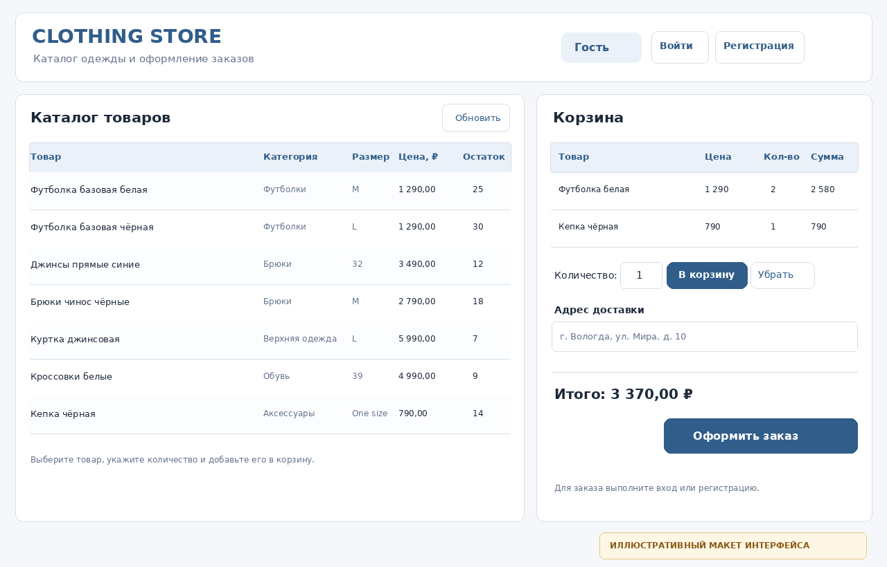
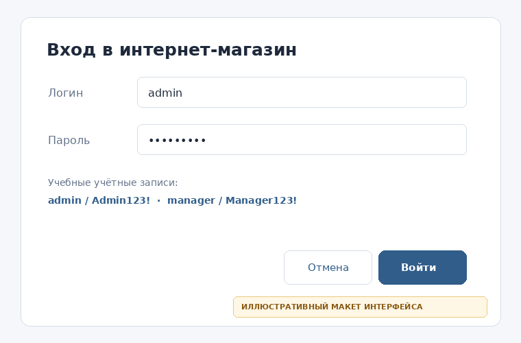
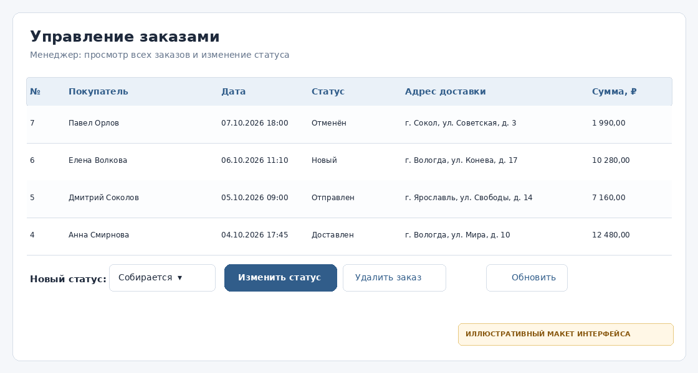

# Clothing Store WPF

Учебное WPF-приложение интернет-магазина одежды для практической работы № 4 по дисциплине «Технология разработки программного обеспечения». Приложение использует реляционную базу данных `Lab3_ClothingStoreDB`, подготовленную в лабораторной работе № 3.

## Elevator pitch

Clothing Store WPF позволяет просматривать каталог одежды, регистрировать покупателей, оформлять заказы и контролировать их состояние. Права интерфейса разделяются по ролям: гость, покупатель, менеджер и администратор. Основные данные хранятся в Microsoft SQL Server; запросы выполняются через параметризованные команды ADO.NET.

## Визуальная демонстрация

Изображения ниже являются **иллюстративными макетами интерфейса**, созданными для описания проектируемых окон, а не снимками фактического запуска приложения. После запуска в Windows их можно заменить настоящими скриншотами.

### Главное окно



### Авторизация



### Управление заказами



## Возможности

- Гостевой режим: просмотр каталога и добавление позиций в локальную корзину; для оформления заказа требуется вход.
- Регистрация покупателей с проверкой обязательных полей, формата электронной почты, длины логина и пароля, а также совпадения паролей.
- Авторизация по логину и паролю. Пароли сохраняются не в открытом виде, а в форме хеша PBKDF2 с индивидуальной солью.
- Покупатель: просмотр только собственных заказов и оформление нового заказа.
- Менеджер: просмотр всех заказов и изменение их статусов.
- Администратор: просмотр и изменение всех заказов, удаление заказа, добавление и редактирование товаров, мягкое скрытие товара из каталога.
- Проверка количества товара и складских остатков; оформление заказа выполняется в транзакции, которая обновляет остатки и сохраняет позиции заказа.
- Обработка ошибок подключения, конфликтов уникальности и некорректного ввода.

## Установка

### Требования

- Windows 10 или Windows 11.
- Visual Studio 2022 с workload **«Разработка классических приложений .NET»** и компонентом **Windows Presentation Foundation (WPF)**.
- .NET 8 SDK / .NET 8 Desktop Runtime.
- Microsoft SQL Server и SQL Server Management Studio (SSMS).

### 1. Подготовить базу данных

Если база данных из лабораторной работы № 3 уже создана и заполнена, повторно запускать основной скрипт не нужно. Если база отсутствует, откройте файл `ClothingStoreWpf/sql/Lab3_ClothingStoreDB.sql` в SSMS и выполните его. **Скрипт лабораторной работы № 3 пересоздаёт пять учебных таблиц** `Customers`, `Categories`, `Products`, `Orders`, `OrderItems` в `Lab3_ClothingStoreDB` и удаляет прежние данные в этих таблицах перед повторным созданием.

### 2. Проверить подключение

По умолчанию используется Windows-аутентификация и строка подключения:

```text
Server=localhost;Database=Lab3_ClothingStoreDB;Integrated Security=True;TrustServerCertificate=True;
```

Если экземпляр SQL Server у вас называется иначе, откройте `ClothingStoreWpf/Services/Database.cs` и измените `Server=localhost` на имя вашего экземпляра, например `Server=.\SQLEXPRESS`. Альтернативно перед запуском можно задать переменную среды `CLOTHING_STORE_CONNECTION` с собственной строкой подключения.

У учётной записи SQL Server должны быть права на чтение и изменение основных таблиц, а также на создание `dbo.AppUsers` при первом запуске приложения. Эта таблица расширяет схему лабораторной № 3 данными для авторизации и ролями. Приложение создаёт её автоматически.

### 3. Открыть и запустить проект

1. Откройте `ClothingStoreWpf.sln` в Visual Studio.
2. Дождитесь восстановления NuGet-пакета `Microsoft.Data.SqlClient`.
3. Выберите конфигурацию `Debug` и платформу `Any CPU`.
4. Назначьте `ClothingStoreWpf` запускаемым проектом, если это необходимо.
5. Нажмите **F5** или **Ctrl+F5**.

При первой успешной инициализации приложение создаёт демонстрационные учётные записи администратора и менеджера. Зарегистрированный пользователь получает роль покупателя.

## Использование

### Учебные учётные записи

| Роль | Логин | Пароль | Возможности |
|---|---|---|---|
| Администратор | `admin` | `Admin123!` | Каталог, все заказы, смена статуса, удаление заказов, управление товарами |
| Менеджер | `manager` | `Manager123!` | Просмотр всех заказов и изменение их статусов |
| Покупатель | Регистрация в приложении | Собственный пароль | Просмотр каталога, оформление заказа, просмотр своих заказов |
| Гость | Не требуется | Не требуется | Просмотр каталога и работа с временной корзиной без оформления заказа |

Демонстрационные пароли приведены для локальной учебной работы. Не используйте их для публичного развёртывания.

### Основной сценарий покупателя

1. Нажмите «Регистрация» и заполните обязательные поля.
2. Выберите товар в каталоге, укажите количество и нажмите «В корзину».
3. Укажите адрес доставки и нажмите «Оформить заказ».
4. Откройте «Заказы», чтобы увидеть статус и сумму своего заказа.

### Сценарий администратора или менеджера

1. Войдите под соответствующей учётной записью.
2. Откройте «Заказы».
3. Выберите заказ, укажите новый статус и нажмите «Изменить статус».
4. Администратор дополнительно может удалить выбранный заказ или открыть «Товары» для редактирования каталога.

## Структура проекта

```text
Pr4_ClothingStoreWpf/
├── README.md
├── ClothingStoreWpf.sln
├── database/                         # скрипт исходной БД из лабораторной № 3
└── ClothingStoreWpf/
    ├── App.xaml                      # ресурсы приложения
    ├── MainWindow.xaml               # каталог и корзина
    ├── Models/Models.cs              # модели и роли
    ├── Services/Database.cs          # SQL Server, запросы и транзакции
    ├── Services/PasswordHasher.cs    # PBKDF2-хеширование паролей
    ├── Views/LoginWindow.xaml        # авторизация
    ├── Views/RegisterWindow.xaml     # регистрация
    ├── Views/OrdersWindow.xaml       # просмотр и управление заказами
    ├── Views/ProductManagementWindow.xaml # каталог для администратора
    ├── sql/Lab3_ClothingStoreDB.sql  # база данных из лабораторной № 3
    ├── sql/extend_database.sql      # описание дополнительной таблицы
    └── docs/screenshots/             # иллюстративные макеты окон
```

## Данные и схема

Основные таблицы не заменяются и используются повторно из лабораторной работы № 3:

- `Customers` — данные покупателей;
- `Categories` — категории товаров;
- `Products` — товары, цена и складской остаток;
- `Orders` — заказы, статус и адрес доставки;
- `OrderItems` — состав заказа, количество и цена на момент оформления.

Добавочная таблица `AppUsers` содержит логин, хеш пароля, роль, признак активности учётной записи и необязательную ссылку на покупателя. Для ролей администратора и менеджера `CustomerID` не задан. Новые покупатели связаны с записями `Customers`.

## Версионный контроль

В архиве проекта хранится локальная Git-история с отдельными коммитами для структуры проекта, доступа к данным, окон интерфейса и документации. Удалённый репозиторий в GitHub/GitLab нужно создать в собственном аккаунте и подключить: внешний репозиторий нельзя создать без авторизации владельца.

Пример публикации в GitHub после создания пустого репозитория:

```bash
git remote add origin https://github.com/<ваш-логин>/<название-репозитория>.git
git branch -M main
git push -u origin main
```

Проверить историю и состояние локальной копии:

```bash
git log --oneline
git status
```

## Обработка ошибок и ограничения

- SQL-запросы используют параметры, а не конкатенацию пользовательского ввода.
- Валидация на уровне интерфейса дополняется ограничениями `CHECK`, `UNIQUE` и внешними ключами в базе данных.
- Оформление заказа и удаление заказа с позициями используют транзакции.
- При удалении товара он помечается неактивным, чтобы не нарушать историю заказов.
- Роли контролируют доступность действий в интерфейсе. Для настоящей многопользовательской системы необходимо дополнительно ограничивать права на уровне сервера/БД и не выдавать приложение с правами владельца базы.

## Лицензия

Учебный проект распространяется по лицензии MIT. Текст лицензии находится в файле `LICENSE`.
